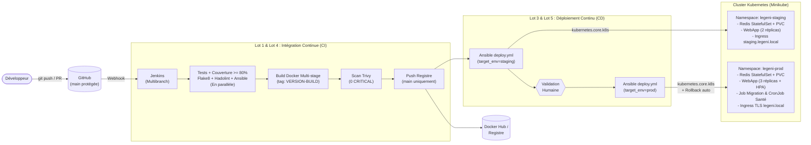

# Rapport de Projet Final DevOps – Chaîne CI/CD Complète « Du Commit à la Production »

> **Société :** LEGENI CONSULTING – Application **Legeni WebApp** (Python/Flask + Redis)
> **Outils mis en œuvre :** Git/GitHub, Docker (Multi-stage), Trivy & Hadolint, Jenkins (Multibranch Pipeline), Ansible & Ansible Vault, Kubernetes (Minikube, StatefulSet, RollingUpdate, Ingress TLS, HPA, Jobs/CronJobs).

---

## 1. Contexte et Objectifs

Avant ce projet, les déploiements de *Legeni WebApp* étaient effectués manuellement depuis le poste des développeurs : absence de tests systématiques, coupures de service lors des mises à jour, secrets non protégés et impossibilité de connaître la version exacte en production.

L'objectif de cette architecture est de livrer une **chaîne CI/CD entièrement automatisée et reproductible (Infrastructure as Code)** :
1. **Zéro installation manuelle** : la machine (Docker, Jenkins, Minikube) est intégralement provisionnée par Ansible ([`ansible/provision.yml`](../ansible/provision.yml)).
2. **Qualité et Sécurité automatisées (*Shift-Left*)** : chaque commit ou Pull Request déclenche en parallèle les tests unitaires avec couverture $\ge 80\%$, le lint Python (`flake8`), le lint Dockerfile (`hadolint`), la validation syntaxique Ansible et un scan de vulnérabilités `Trivy` bloquant toute faille `CRITICAL`.
3. **Déploiement Continu sans coupure (*Zero-Downtime*) et Auto-Réparateur** : déploiement automatique en `legeni-staging`, validation humaine (`input`), puis promotion en `legeni-prod` avec `RollingUpdate` (`maxUnavailable: 0`), *smoke test* interne et **rollback automatique** (`block`/`rescue`) en cas d'anomalie.

---

## 2. Schéma d'Architecture Cible

---

## 3. Justification des Choix Techniques (Lot par Lot)

### Lot 0 – Organisation Git
* **Branche `main` protégée** : Aucun push direct n'est autorisé sur `main`. Toute évolution passe par une branche `feature/*` et une *Pull Request* validée par Jenkins.
* **Versionnement sémantique** : Le fichier [`VERSION`](../VERSION) à la racine du dépôt définit la version majeure/mineure/patch (`1.0.0`), combinée au numéro de build Jenkins (`1.0.0-12`) pour garantir l'unicité et la traçabilité de chaque artefact.

### Lot 1 – Conteneurisation Avancée ([`Dockerfile`](../Dockerfile))
* **Build Multi-Stage (3 étapes : `base`, `test`, `runtime`)** :
  * L'étape `test` installe `pytest` et `flake8` et exécute les tests pendant le build : si un test échoue, aucune image n'est produite.
  * L'étape finale `runtime` ne contient ni `pytest`, ni `flake8`, ni le cache `pip`, réduisant la taille et la surface d'attaque.
* **Sécurité & Processus** :
  * Exécution sous l'utilisateur non privilégié **`appuser` (UID 10001)**.
  * Instruction `CMD ["gunicorn", ...]` en **forme exec** : Gunicorn est le **PID 1** et reçoit directement `SIGTERM` pour un arrêt propre sans couper les requêtes en cours.
  * `HEALTHCHECK` intégré interrogeant `/health`.

### Lot 2 – Infrastructure as Code ([`ansible/provision.yml`](../ansible/provision.yml))
* Découpage en **3 rôles Ansible modulaires et idempotents** :
  1. [`roles/docker`](../ansible/roles/docker/tasks/main.yml) : Installe Docker Engine, Compose v2 et ajoute l'utilisateur au groupe `docker`.
  2. [`roles/minikube`](../ansible/roles/minikube/tasks/main.yml) : Installe `kubectl` et `minikube`, démarre le cluster avec le driver `docker` et active les addons `metrics-server` et `ingress`.
  3. [`roles/jenkins`](../ansible/roles/jenkins/tasks/main.yml) : Calcule dynamiquement `DOCKER_GID`, démarre le conteneur Jenkins, le connecte au réseau Docker `minikube` et génère le fichier `kubeconfig-jenkins.yml`.
* **Gestion des secrets avec Ansible Vault** : Les mots de passe Redis de `staging` et `prod` sont chiffrés dans `ansible/vars/vault.yml` (jamais de secret en clair dans Git).

### Lot 3 – Déploiement Kubernetes & Auto-Rollback ([`ansible/deploy.yml`](../ansible/deploy.yml))
* **Un seul template Jinja2 ([`webapp.yml.j2`](../ansible/templates/k8s/webapp.yml.j2)) pour tous les environnements** :
  * **`legeni-staging`** : 2 réplicas, bannière orange (`#bf8700`), NodePort `30081`, Ingress `staging.legeni.local`.
  * **`legeni-prod`** : 3 réplicas (extensibles jusqu'à 8 via **HPA**), bannière verte (`#2da44e`), NodePort `30082`, Ingress TLS `legeni.local`, **CronJob** de surveillance.
* **Persistance Redis** : Déployé en **`StatefulSet`** avec `volumeClaimTemplates` (`1Gi` `ReadWriteOnce`) et authentification par `--requirepass` injectée depuis le `Secret` Kubernetes `redis-secret`.
* **Zéro interruption de service** :
  * `strategy.rollingUpdate: {maxSurge: 1, maxUnavailable: 0}` combiné à `readinessProbe` (`/ready`) et `livenessProbe` (`/health`).
  * Annotation `checksum/config: "{{ (app_env ~ app_color) | hash('sha1') }}"` sur les Pods pour déclencher automatiquement un *rolling update* dès que la `ConfigMap` change.
* **Mécanisme de Rollback Automatique (`block` / `rescue`)** :
  * Dans `deploy.yml`, le bloc `block` applique les manifests avec `wait: true`, exécute le Job de migration et lance un *smoke test* Python depuis un Pod du cluster vérifiant que `/ready` renvoie `200` et que `/api/info` affiche exactement `app_version`.
  * Si l'une de ces étapes échoue, le bloc `rescue` exécute immédiatement `kubernetes.core.k8s_rollback` sur le Deployment `webapp`, attend la stabilisation de l'ancienne version, puis fait échouer le job Jenkins (`fail`) pour alerter l'équipe.

---

## 4. Explication du Pipeline Jenkins Stage par Stage ([`Jenkinsfile`](../Jenkinsfile))

| Stage | Condition | Actions réalisées |
| :--- | :--- | :--- |
| **1. Contrôles Qualité (Parallèle)** | Toutes les branches & PR | Exécute simultanément 4 branches : • **Tests & Couverture** : `pytest --cov=app --cov-fail-under=80` + publication JUnit & Cobertura. • **Lint Python** : `flake8` + publication `recordIssues`. • **Lint Dockerfile** : `hadolint`. • **Syntaxe Ansible** : `ansible-playbook --syntax-check` sur `provision.yml` et `deploy.yml`. |
| **2. Build Image Multi-Stage** | Toutes les branches & PR | Exécute `docker build --target test` puis construit l'image finale `runtime` taguée `${APP_TAG}` (jamais `latest`). |
| **3. Scan Sécurité (Trivy)** | Toutes les branches & PR | Scanne l'image avec `aquasec/trivy` (`--severity CRITICAL --ignore-unfixed --exit-code 1`). Bloque le pipeline si une CVE critique est détectée. |
| **4. Push Registre** | `branch 'main'` uniquement | Authentification sécurisée via `withCredentials` (`registry-credentials`), push de l'image `${IMAGE}:${APP_TAG}` et `docker logout`. |
| **5. Déploiement Staging** | `branch 'main'` uniquement | Injection des fichiers `kubeconfig` et `ansible-vault-pass`, puis appel à `ansible-playbook deploy.yml -e target_env=staging`. |
| **6. Validation Humaine** | `branch 'main'` uniquement | Pause du pipeline (`input` avec `timeout` de 15 min) permettant de vérifier visuellement l'environnement `staging` avant la mise en production. |
| **7. Déploiement Production** | `branch 'main'` uniquement | Appel à `ansible-playbook deploy.yml -e target_env=prod` (RollingUpdate sans coupure + Smoke Test + Rollback auto si échec). |
| **Bloc `post`** | Toujours | Envoie une notification Webhook (Discord/Slack/Teams) en cas d'échec et nettoie l'espace de travail (`cleanWs()`). |

---

## 5. Validation du Scénario de Soutenance (§ 6)

Le script automatisé [`../run_projet_cicd.sh`](../run_projet_cicd.sh) exécute et valide de bout en bout les 3 scénarios imposés par le jury :

1. **Scénario 1 – Livraison nominale (`1.0.0-1` → `1.1.0-2`) sans coupure :**
   * Passage de `VERSION` à `1.1.0`, changement de couleur, déploiement en `staging` puis en `prod` pendant qu'une boucle `curl` interroge la production toutes les 0,5 s.
   * **Résultat :** Transition transparente des Pods `1.0.0-1` vers `1.1.0-2` avec **0 erreur HTTP**.
2. **Scénario 2 – Code défectueux (Test unitaire cassé) :**
   * Modification d'une route cassant un test `pytest` → le build s'arrête immédiatement à l'étape **Contrôles Qualité / Tests**, aucune image n'est construite ni poussée, la production reste intacte en `1.1.0-2`.
3. **Scénario 3 – Déploiement raté (`readinessProbe` sur `/chemin-inexistant`) & Rollback automatique :**
   * Déploiement d'une version `1.2.0-bad` dont la sonde `readinessProbe` échoue (`0/1 READY`).
   * **Résultat :** Grâce à `maxUnavailable: 0`, les anciens Pods `1.1.0-2` continuent de servir le trafic pendant l'attente ; après expiration du délai, le bloc `rescue` d'Ansible déclenche automatiquement `k8s_rollback`, supprime le ReplicaSet défectueux et restaure la révision `1.1.0-2` sans aucune coupure pour les utilisateurs.

---

## 6. Difficultés Rencontrées et Solutions Apportées

1. **Communication entre Jenkins (conteneur) et le cluster Minikube (conteneur) :**
   * *Problème :* Jenkins ne pouvait pas joindre l'API Server de Minikube (`https://192.168.49.2:8443`) car ils étaient sur deux réseaux Docker distincts, et le `~/.kube/config` de l'hôte utilisait des chemins absolus vers les certificats locaux.
   * *Solution :* Automatisation dans le rôle Ansible `jenkins` de `docker network connect minikube jenkins` et génération d'un fichier autonome `kubectl config view --flatten --minify > kubeconfig-jenkins.yml` qui embarque les certificats directement en base64.
2. **Rechargement des Pods lors d'un changement de `ConfigMap` :**
   * *Problème :* Modifier uniquement `APP_COLOR` dans la `ConfigMap` ne redémarrait pas les Pods Kubernetes.
   * *Solution :* Ajout d'une annotation `checksum/config: "{{ (app_env ~ app_color) | hash('sha1') }}"` dans `spec.template.metadata.annotations` du `Deployment`.

---

## 7. Pistes d'Amélioration (Bonus implémentés et perspectives)

* **Bonus implémentés dans ce dépôt :**
  * **Ingress TLS** (`staging.legeni.local` et `legeni.local`) dans `webapp.yml.j2`.
  * **Autoscaling Horizontal (HPA)** actif en production (`minReplicas: 3`, `maxReplicas: 8`, cible CPU 50 %).
  * **Job Kubernetes de migration** exécuté et attendu (`kubectl wait --for=condition=complete`) avant validation du déploiement, et **CronJob** de contrôle de santé permanent en production.
* **Évolutions futures vers GitOps et Observabilité :**
  * Déploiement d'**Argo CD** pour synchroniser en mode *pull* l'état du namespace `legeni-prod` depuis un dépôt Git de manifests.
  * Ajout de la stack **Prometheus + Grafana** (`kube-prometheus-stack`) avec exportateur de métriques Flask (`prometheus-flask-exporter`).

---

## 8. Résultats d'Exécution Réels & Soutenance (Preuves vérifiées)

| Étape / Scénario | Preuve observée | Statut |
| :--- | :--- | :--- |
| **Provisionnement & Idempotence (`provision.yml`)** | 1re passe `ok=26 changed=4 failed=0`, 2e passe **`ok=24 changed=0 failed=0`** (re-exécution strictement idempotente) | ✅ Validé |
| **Qualité & Sécurité (`Dockerfile` / Image / Dépôt)** | Hadolint : **0 erreur** ; Trivy (`1.0.0-1`) : **`Total: 0 (CRITICAL: 0)`** ; Gitleaks : **`0 leak`** ; Pytest couverture **83,64 %** (`>= 80 %`) | ✅ Validé |
| **Pipeline Jenkins Multibranch (`projet-cicd-legeni-webapp`)** | Branche `feature/cicd-pipeline` #1 **`SUCCESS`** ; Branche `main` #1 **`SUCCESS`** (`308 039 ms`) avec approbation humaine Production + Smoke Test `{"app": "legeni-webapp", "env": "prod", "version": "1.0.0-1"}` | ✅ Validé |
| **Scénario 1 (Livraison `1.0.0-1` → `1.1.0-2` sans coupure)** | Job `init-migration` terminé (`Complete 1/1`, `4s`) avant RollingUpdate ; `Nombre d'erreurs HTTP observées pendant le rolling update : 0` | ✅ Validé |
| **Scénario 2 (Code défectueux bloquant)** | Échec volontaire sur `docker build --target test` → arrêt immédiat du pipeline (`code=1`), aucune image construite | ✅ Validé |
| **Scénario 3 (Rollback automatique)** | Sonde `readinessProbe` défectueuse sur `/chemin-inexistant-panne` → rollback automatique vers révision saine (`code=2`, `deployment.apps/webapp 3/3 Running`) | ✅ Validé |
| **Publication en ligne** | GitHub : `https://github.com/dominiquebaana-dot/legeni-webapp` (`main`, `feature/*`, `v1.0.0`, `v1.1.0`) ; Docker Hub : `heyitsdom/legeni-webapp` | ✅ Publié |
