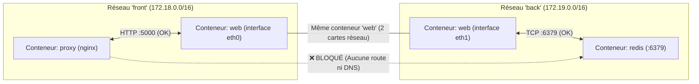

# Compte-Rendu Complet – Travaux Pratiques Docker (TP 2.2 à TP 2.10)

> **Module 2 – Conteneurisation avec Docker**
> Ce document regroupe l'ensemble des réponses aux questions, les tableaux comparatifs complétés, les schémas d'architecture, les commandes de vérification et les solutions des défis pour les **TPs 2.2 à 2.10**.
> Tous les fichiers associés sont prêts à l'emploi dans le dossier [`solutions/`](solutions/) et exécutables automatiquement via [`run_all_tp_docker.sh`](run_all_tp_docker.sh).

---

## TP 2.2 : Installation de Docker et cycle de vie d'un conteneur

### 1. Réponses aux questions
* **Que se passe-t-il réellement quand vous tapez une commande `docker` (`Client` vs `Server`) ?**
  * La commande `docker` est uniquement un **client CLI** léger. Lorsqu'on exécute une commande (ex. `docker run` ou `docker ps`), le client envoie une requête **API REST** au démon `dockerd` (le **Server**) à travers le socket Unix `/var/run/docker.sock` (qui appartient à `root:docker`). C'est le démon `dockerd` (via `containerd` et `runc`) qui télécharge les images et crée/gère réellement les conteneurs auprès du noyau Linux.
* **Quelle différence entre `docker stop` et `docker rm` ? Entre `docker rm` et `docker rmi` ?**
  * `docker stop` arrête le processus principal du conteneur (envoie `SIGTERM` puis `SIGKILL`), mais le conteneur et sa couche d'écriture restent présents sur le disque à l'état `Exited` (on peut le relancer avec `docker start`).
  * `docker rm` supprime définitivement l'**instance de conteneur** et sa couche d'écriture éphémère.
  * `docker rmi` supprime l'**image** (le modèle en lecture seule) du cache local de la machine.
* **Pourquoi la modification de `index.html` a-t-elle survécu à `stop/start` mais pas à `rm` + `run` ?**
  * Chaque conteneur possède une fine **couche inscriptible (*writable layer* / Copy-on-Write)** au-dessus des couches immuables de l'image. `stop/start` conserve ce conteneur et sa couche inscriptible. En revanche, `docker rm` détruit cette couche inscriptible, et `docker run` repart d'une image neuve.
  * **Conclusion :** Le code/contenu statique d'une application doit être intégré dans l'**image** via un `Dockerfile` (TP 2.3), tandis que les données dynamiques/persistantes doivent être stockées dans un **volume** (TP 2.4).

### 2. Fichiers réalisés
* Stack Odoo + PostgreSQL : [`solutions/tp2.2/odoo-compose/compose.yml`](solutions/tp2.2/odoo-compose/compose.yml)
* Script du Défi Redis : [`solutions/tp2.2/defi_tp22.sh`](solutions/tp2.2/defi_tp22.sh)

### 3. Solution du Défi TP 2.2
```bash
docker run -d --name cache redis:7.4-alpine
docker exec cache redis-cli SET cours devops
docker exec cache redis-cli GET cours                 # -> "devops"
docker inspect -f '{{range .NetworkSettings.Networks}}{{.IPAddress}}{{end}}' cache
docker rm -f cache
```

### 4. Vérifications
- [x] `docker ps` fonctionne sans `sudo`
- [x] `docker compose version` affiche `Docker Compose version v2.x`
- [x] Aucun conteneur `web` restant après nettoyage (`docker ps -a`)
- [x] Services `db` et `odoo` à l'état `running` et persistance validée après `docker compose down` / `up -d`

---

## TP 2.3 : Dockerfile, image, conteneur et Docker Hub (Site Restaurant)

### 1. Rôle et moment d'exécution de chaque instruction du Dockerfile
| Instruction | Rôle | Moment d'exécution |
| :--- | :--- | :--- |
| `FROM ubuntu:24.04` | Définit l'image de base du système de fichiers | **Build** |
| `LABEL maintainer="Legeni"` | Ajoute des métadonnées à l'image | **Build** |
| `RUN apt-get update` | Met à jour l'index des paquets APT dans une nouvelle couche | **Build** |
| `RUN apt-get install -y nginx git` | Installe Nginx et Git dans une couche d'image | **Build** |
| `RUN rm -Rf /var/www/html/*` | Nettoie la page par défaut de Nginx | **Build** |
| `RUN git clone ... /var/www/html/` | Clone le code source du site restaurant dans l'image | **Build** |
| `EXPOSE 80` | Documente le port d'écoute du conteneur | **Build** (métadonnée) |
| `ENTRYPOINT ["/usr/sbin/nginx", "-g", "daemon off;"]` | Définit le processus principal lancé au démarrage | **Run (Démarrage)** |

### 2. Réponses aux questions
1. **Pourquoi `DEBIAN_FRONTEND=noninteractive` ?**
   * Sans cette variable, l'installation de certains paquets (comme `tzdata`, dépendance de `nginx`/`git`) attend une saisie clavier interactive (choix du fuseau horaire), ce qui bloque indéfiniment un build automatisé.
2. **Pourquoi nginx est-il lancé avec `daemon off;` ?**
   * Par défaut, Nginx se détache en arrière-plan (*daemon*) et son processus parent se termine immédiatement. Or, un conteneur Docker ne vit que tant que son processus numéro 1 (**PID 1**) est actif : sans `daemon off;`, le conteneur s'arrête aussitôt (`Exited (0)`).
3. **`EXPOSE 80` publie-t-il le port sur la machine hôte ?**
   * **Non.** `EXPOSE` est purement déclaratif (documentation entre la personne qui écrit l'image et celle qui l'exploite, ou pour `-P`). Pour ouvrir réellement le port sur l'hôte, il faut utiliser `-p <hote>:<conteneur>` lors du `docker run`.
4. **Pourquoi l'ordre des instructions est-il crucial pour le cache ?**
   * Dès qu'une instruction change (ex. modification du `LABEL` en haut du fichier), le cache de cette couche **et de toutes les couches suivantes** est invalidé. Il faut donc placer en premier ce qui change rarement (système, dépendances) et en dernier ce qui change souvent (code source).
5. **Pourquoi faire `apt-get update` et `apt-get install` dans le même `RUN` ?**
   *1) Si `apt-get update` est dans un `RUN` séparé, Docker met cette couche en cache : si on ajoute un paquet plus tard, Docker réutilise un vieil index obsolète et l'installation échoue (`404 Not Found`).
   *2) Supprimer `/var/lib/apt/lists/*` dans un `RUN` ultérieur ne réduit **pas** la taille de l'image car les couches précédentes sont immuables ; tout doit être fait dans la même instruction `RUN`.
6. **Différence observée entre `:v1` (`ENTRYPOINT`) et `:v2` (`CMD`) lors de `docker run ... cat /etc/os-release` :**
   * Avec `v2` (`CMD`), la commande `cat /etc/os-release` **remplace** la commande par défaut (`nginx`) et affiche la version d'Ubuntu.
   * Avec `v1` (`ENTRYPOINT`), `cat /etc/os-release` est passé comme **argument** à `/usr/sbin/nginx`, ce qui provoque une erreur Nginx (`invalid option`).

### 3. Fichiers réalisés (dont Défi v3) & Tailles mesurées
* [`solutions/tp2.3/Dockerfile`](solutions/tp2.3/Dockerfile) (v1)
* [`solutions/tp2.3/Dockerfile.v2`](solutions/tp2.3/Dockerfile.v2) (v2 optimisée)
* [`solutions/tp2.3/Dockerfile.v3`](solutions/tp2.3/Dockerfile.v3) (Défi : injection `--build-arg VERSION=v3` et date de build via `sed`)

| Tag | Taille disque (`DISK USAGE`) | Taille contenu (`CONTENT SIZE`) | Observations |
| :--- | :--- | :--- | :--- |
| `legeni_static_website:v1` | `356MB` | `102MB` | Mono-couches `apt-get` séparées + `ubuntu:24.04` + `ENTRYPOINT` |
| `legeni_static_website:v2` | `294MB` | `74.3MB` | `--no-install-recommends`, `--depth 1`, nettoyage `/var/lib/apt/lists/*` dans le même `RUN`, `CMD` |
| `legeni_static_website:v3` | `294MB` | `74.3MB` | Identique à `v2` + pied de page injecté `Version : v3 – 2026-11-17` |

### 4. Vérifications
- [x] Images `v1`, `v2` et `v3` construites et comparées (`v1` 356MB -> `v2`/`v3` 294MB)
- [x] Différence `ENTRYPOINT` (`v1`) vs `CMD` (`v2`) constatée
- [x] Défi `v3` validé avec `<p style="text-align:center">Version : v3 – 2026-11-17</p>`

---

## TP 2.4 : Réseaux et volumes – faire communiquer et persister

### 1. Réponse à la question
* **Pourquoi l'absence de résolution DNS sur le réseau `bridge` par défaut est-elle un problème ?**
  * Sur le bridge par défaut (`docker0`), les conteneurs ne peuvent se joindre que par leur adresse IP (`172.17.0.x`). Or, l'adresse IP d'un conteneur est **éphémère** et change dès que le conteneur est recréé ou redémarré. Sur un réseau bridge personnalisé (`docker network create`), Docker active son serveur DNS embarqué (`127.0.0.11`) qui résout automatiquement le nom du conteneur vers son IP actuelle.

### 2. Tableau de synthèse complété

| Critère | Volume anonyme | Volume nommé | Bind mount (TP 2.7) |
| :--- | :--- | :--- | :--- |
| **Syntaxe `-v`** | `-v /chemin` | `-v nom:/chemin` | `-v /dossier/hote:/chemin` |
| **Créé et géré par** | Docker (`/var/lib/docker/volumes/<hash>/`) | Docker (`/var/lib/docker/volumes/<nom>/`) | L'utilisateur sur le système de fichiers hôte |
| **Supprimé par `docker rm -v`** | **Oui** | **Non** (protégé, suppression explicite via `docker volume rm`) | **Non** (persiste sur le disque hôte) |
| **Usage typique** | Cache temporaire ou partage éphémère (`--volumes-from`) | Bases de données en production (PostgreSQL, Redis, MySQL) | Développement local (code rechargé à chaud) ou injection d'un fichier de config hôte |

### 3. Script d'exécution & Solution du Défi
* Script complet (Étapes 1 à 6 + Défi 3-tiers `frontend`/`backend`/`api`/`web`/`db`) : [`solutions/tp2.4/tp24_reseaux_volumes.sh`](solutions/tp2.4/tp24_reseaux_volumes.sh)

### 4. Vérifications
- [x] Résolution DNS entre `B3_jour` et `B3_soir` sur `mon_reseau` (`172.20.0.0/16`)
- [x] Volume anonyme partagé puis supprimé avec `docker rm -v` ; volume nommé `mon_volume_persistant` et `pg_data` conservés après recréation
- [x] Isolation 3-tiers : `web -> api` OK, `api -> db` OK, `web -> db` bloqué

---

## TP 2.5 : Configuration, `ARG`/`ENV`, `ENTRYPOINT`/`CMD` et PID 1

### 1. Réponses aux questions
* **Variables lues par `app-fil-rouge/app.py` et leurs valeurs par défaut :**
  * `APP_VERSION` (défaut : `"dev"`)
  * `APP_ENV` (défaut : `"dev"`)
  * `APP_COLOR` (défaut : `"#1f6feb"`)
  * `REDIS_HOST` (défaut : `None` → bascule automatiquement sur le compteur en mémoire `MemoryCounter`)
  * `REDIS_PORT` (défaut : `"6379"`)
  * `REDIS_PASSWORD` (défaut : `None`)
  * `PORT` (défaut : `"5000"`, utilisé si lancé directement via `python app.py`)
* **Pourquoi un arrêt brutal (`SIGKILL`) est-il dangereux ?**
  * `SIGKILL` (signal 9) est intercepté directement par le noyau Linux qui tue immédiatement le processus sans lui laisser le temps de fermer ses fichiers, vider ses tampons sur disque (*flush*) ou terminer les requêtes HTTP/SQL en cours. Cela peut corrompre une base de données ou provoquer des erreurs `502 Bad Gateway` pour les utilisateurs.
* **Quelle forme utilise le `CMD` de `app-fil-rouge/Dockerfile` ?**
  * Il utilise la **forme exec** : `CMD ["gunicorn", "--bind", "0.0.0.0:5000", "--workers", "2", "--access-logfile", "-", "app:app"]`. Ainsi, `gunicorn` est directement le **PID 1**, reçoit `SIGTERM` lors d'un `docker stop` et s'arrête proprement en moins d'une seconde.

### 2. Tableau comparatif `ARG` vs `ENV`

| Propriété | `ARG` | `ENV` |
| :--- | :--- | :--- |
| **Disponible pendant le `docker build`** | **Oui** | **Oui** (à partir de sa déclaration) |
| **Disponible dans le conteneur à l'exécution** | **Non** (sauf s'il est recopié dans un `ENV`) | **Oui** |
| **Modifiable au `docker run`** | **Non** (uniquement au build via `--build-arg`) | **Oui** (via `-e` ou `--env-file`) |
| **Visible dans `docker history` / `docker inspect`** | **Oui** (dans `docker history` → ne jamais y mettre de secret !) | **Oui** (dans `docker inspect` et `history`) |

### 3. Fichiers réalisés (dont Défi `demo:wait`)
* Tous les fichiers et scripts sont dans [`solutions/tp2.5/`](solutions/tp2.5/) (notamment [`wait.sh`](solutions/tp2.5/wait.sh) et [`Dockerfile.wait`](solutions/tp2.5/Dockerfile.wait)).

### 4. Vérifications
- [x] Injection `APP_VERSION`, `APP_ENV`, `APP_COLOR` via `-e` et `--env-file`
- [x] Bascule vers Redis (`REDIS_HOST=redis_tp25`) vérifiée sur `/ready`
- [x] Comparaison PID 1 : forme `shell` vs forme `exec` (arrêt propre sur `SIGTERM`) et Défi `demo:wait` validés

---

## TP 2.6 : Dockerfile avancé – Multi-stage, Cache, Non-root et Healthcheck

### 1. Réponses aux questions
* **Pourquoi `git` et le cache `apt` se retrouvent-ils dans l'image finale du TP 2.3 ?**
  * Parce qu'un Dockerfile mono-étape conserve tous les outils installés pour récupérer/compiler l'application (`git`, compilateurs, listes `apt`). Cela alourdit l'image (`356MB` disque / `102MB` contenu pour `restaurant:ubuntu` sur 12 entrées `docker history`, contre `77.8MB` / `22.9MB` sur `restaurant:alpine` et `75.7MB` / `21.9MB` sur `restaurant:multistage`) et augmente la surface d'attaque (plus de binaires = plus de failles CVE potentielles).
* **Que se passe-t-il si on place `COPY . .` avant `RUN pip install -r requirements.txt` ?**
  * À la moindre modification d'une ligne de code dans `app.py`, la couche `COPY . .` est invalidée, ce qui invalide la couche suivante `RUN pip install` et oblige Docker à **retélécharger et réinstaller tous les paquets Python** à chaque build ! En copiant uniquement `requirements.txt` d'abord, la couche `pip install` reste en cache (`CACHED`).
* **Quel est le risque de faire tourner un conteneur en `root` ?**
  * Par défaut, le `root` (UID 0) du conteneur est le **même UID 0 que le `root` du noyau hôte**. En cas de faille dans l'application ou d'évasion de conteneur (ou d'un volume hôte monté par erreur), l'attaquant obtient immédiatement les privilèges d'administrateur sur le serveur. Utiliser `USER appuser` (UID 10001) applique le principe du moindre privilège.

### 2. Fichiers réalisés (dont Défi Multi-stage Restaurant) & Tailles mesurées
* [`solutions/tp2.6/Dockerfile.alpine`](solutions/tp2.6/Dockerfile.alpine) (`nginx:1.27-alpine` mono-étape -> `77.8MB` / `22.9MB`)
* [`solutions/tp2.6/Dockerfile.multistage`](solutions/tp2.6/Dockerfile.multistage) (étape 1 `alpine/git:v2.47.1` -> étape 2 `nginx:1.27-alpine` + `HEALTHCHECK` -> `75.7MB` / `21.9MB`, état `healthy`)
* Multi-stage `app-fil-rouge` : `legeni-webapp:test` (`200MB` / `48.2MB`) vs `legeni-webapp:1.0.0` (`191MB` / `46.2MB`), contexte réduit par `.dockerignore` (3.91kB vs 63B), `id` = `uid=10001(appuser)`, test volontairement cassé bloquant sur `--target test`.

---

## TP 2.7 : Réseaux et stockage en profondeur

### 1. Schéma d'isolation 3-tiers (`proxy` ↔ `web` ↔ `redis`)



### 2. Réponse à la question (Publication de ports)
* **Quel mode choisir pour une base de données qui ne doit pas être exposée sur Internet ?**
  * Idéalement, **aucune publication de port (`-p`)** : la base reste uniquement sur un réseau bridge interne (`backend`) accessible seulement aux conteneurs applicatifs. Si un outil d'administration local sur l'hôte doit y accéder, il faut restreindre l'écoute à l'interface de bouclage locale : `-p 127.0.0.1:5432:5432`.

### 3. Fichiers réalisés & Vérifications
* Script complet des étapes : [`solutions/tp2.7/tp27_reseaux_stockage.sh`](solutions/tp2.7/tp27_reseaux_stockage.sh)
* Script du Défi (`backup_volume.sh` avec rotation des 7 dernières archives) : [`solutions/tp2.7/backup_volume.sh`](solutions/tp2.7/backup_volume.sh)
* Vérifié : isolation 3-tiers (`proxy -> redis` bloqué), bind mount à chaud `v1` -> `v2` + `:ro` (`Read-only file system`), `tmpfs` `/run/secrets` (1.0M, vidé au redémarrage), sauvegarde/restauration `redis_data` (`devops`), rotation conservant exactement **7** archives après 8 sauvegardes.

---

## TP 2.8 : Docker Compose – Stack multi-services prête pour la production

### 1. Réponses aux questions
* **Que se passerait-il si on supprimait `REDIS_HOST` avec `--scale web=3` ?**
  * Sans `REDIS_HOST`, chaque conteneur `web` utilise la classe `MemoryCounter` (variable stockée dans la RAM propre à chaque conteneur). Avec 3 réplicas derrière le reverse-proxy Nginx, chaque rafraîchissement de page afficherait un compteur différent et incohérent selon le conteneur qui répond (1, puis 1, puis 2, puis 1...), et les compteurs retomberaient à zéro au moindre redémarrage.
* **Différence entre `/health` (liveness) et `/ready` (readiness) :**
  * `/health` (**Liveness**) vérifie uniquement que le processus Python/Gunicorn est vivant et ne s'est pas bloqué (renvoie `200 OK` même si Redis est coupé). Si `/health` échoue, l'orchestrateur **redémarre** le conteneur.
  * `/ready` (**Readiness**) vérifie que l'application ET ses dépendances critiques (Redis) sont opérationnelles (renvoie `503 Service Unavailable` quand Redis est arrêté). Si `/ready` échoue, l'orchestrateur **ne tue pas** le conteneur (le redémarrer ne réparerait pas Redis), mais **retire temporairement le pod du répartiteur de charge** pour ne plus lui envoyer de trafic utilisateur.

### 2. Fichiers réalisés & Vérifications
* Stack complète `legeni` : [`solutions/tp2.8/compose.yml`](solutions/tp2.8/compose.yml), [`.env.example`](solutions/tp2.8/.env.example) et [`nginx/default.conf`](solutions/tp2.8/nginx/default.conf)
* Défi WordPress + MariaDB : [`solutions/tp2.8/wordpress/compose.yml`](solutions/tp2.8/wordpress/compose.yml) (`HTTP 200` sur `:8000`)
* Vérifié : scaling `web=3` équilibré derrière `proxy`, persistance compteur Redis après `docker compose down` / `up -d` (`1` -> `2`), et tolérance aux pannes (`/ready` `503` vs `/health` `200` lorsque `redis` est arrêté).

---

## TP 2.9 : Registre privé, stratégie de tags et scan de sécurité

### 1. Réponses aux questions
* **Pourquoi l'image `python:3.6-alpine` de l'ancien projet final est-elle à proscrire ?**
  * Python 3.6 et la version d'Alpine associée sont en fin de vie (*End-of-Life*) depuis fin 2021 : ils ne reçoivent plus aucun correctif de sécurité. Le scan Trivy remonte des dizaines de vulnérabilités `CRITICAL` et `HIGH` (dans `openssl`, `libcrypto`, `zlib`, `pip`, etc.) connues publiquement et exploitables. En outre, les dépôts de paquets et wheels modernes ne les supportent plus.

### 2. Fichiers réalisés & Vérifications
* Dockerfile restaurant corrigé sans avertissement Hadolint : [`solutions/tp2.9/Dockerfile.restaurant.clean`](solutions/tp2.9/Dockerfile.restaurant.clean) (`0 avertissement DL3008/DL3009`, versions `apt` épinglées)
* Script du Défi (`release.sh` : tests → build → scan Trivy bloquant → push double tag `<version>` + `sha-<commit>`) : [`solutions/tp2.9/release.sh`](solutions/tp2.9/release.sh)
* Vérifié : Hadolint `0` erreur sur `app-fil-rouge/Dockerfile`, registre privé `localhost:5000` (`repositories: ["legeni-webapp"]`, tags `["1.0.0","sha-local"]`, `pull` depuis zéro OK), Trivy (`CRITICAL: 0`, `HIGH: 1` `zlib1g` `CVE-2026-85091`).

---

## TP 2.10 : Exploitation et dépannage (Les 5 pannes résolues)

### 1. Diagnostic et résolution des 5 pannes (Partie B)

| Panne | Symptôme observé | Commande(s) de diagnostic | Cause racine identifiée | Correction appliquée |
| :--- | :--- | :--- | :--- | :--- |
| **Panne 1** (`p1`) | `p1` absent de `docker ps` immédiatement après `docker run -d --name p1 ubuntu` | `docker ps -a --filter name=p1`<br>`docker inspect p1` | La commande par défaut d'`ubuntu` est `/bin/bash`. Lancé en arrière-plan (`-d`) sans terminal interactif (`-it`), `bash` n'a rien à lire sur `stdin` et se termine aussitôt (`Exited (0)`). | Maintenir un processus actif ou allouer un TTY :<br>`docker run -d --name p1 ubuntu sleep infinity` *(ou `docker run -dit --name p1 ubuntu`)* |
| **Panne 2** (`p2b`) | Erreur `Bind for 0.0.0.0:8085 failed: port is already allocated` | `docker ps --format "table {{.Names}}\t{{.Ports}}"`<br>`ss -lntp \| grep 8085` | Le conteneur `p2a` écoute déjà sur le port hôte `8085`. Deux processus ne peuvent pas écouter sur le même couple IP:Port hôte. | Publier `p2b` sur un autre port hôte disponible :<br>`docker run -d --name p2b -p 8095:80 nginx:1.27-alpine` |
| **Panne 3** (`p3`) | `curl localhost:8086` renvoie `Empty reply from server` / `Connection reset by peer` | `docker port p3`<br>`docker logs p3`<br>`docker inspect p3` | Le conteneur a été lancé avec `-p 8086:80`, or les logs de Gunicorn montrent qu'il écoute sur `0.0.0.0:5000` (et non `80`). | Mapper le port hôte `8086` vers le port `5000` du conteneur :<br>`docker run -d --name p3 -p 8086:5000 legeni-webapp:1.0.0` |
| **Panne 4** (`p4`) | `curl localhost:8087/ready` renvoie `{"status":"redis indisponible"}` (HTTP 503) | `docker inspect p4 -f '{{json .NetworkSettings.Networks}}'`<br>`docker network inspect p4net` | Double erreur :<br>1) `p4` a été lancé sans `--network p4net` (il est sur le bridge par défaut).<br>2) `REDIS_HOST=redis` alors que le conteneur Redis s'appelle `cache`. | Connecter `p4` au réseau `p4net` et cibler `cache` :<br>`docker run -d --name p4 --network p4net -p 8087:5000 -e REDIS_HOST=cache legeni-webapp:1.0.0` |
| **Panne 5** (`p5`) | `sh: can't create /data/f: Permission denied` sur le bind mount `/tmp/p5:/data` | `docker run --rm legeni-webapp:1.0.0 id`<br>`ls -ldn /tmp/p5` | Le dossier hôte `/tmp/p5` appartient à `root:root` (`0:0`) en mode `755`, tandis que le conteneur tourne sous l'utilisateur non-root `appuser` (`UID 10001`). | Donner la propriété du dossier hôte à l'UID `10001` :<br>`sudo chown 10001:10001 /tmp/p5` *(ou utiliser un volume nommé Docker)* |

* Script reproduisant et corrigeant automatiquement les 5 pannes : [`solutions/tp2.10/depannage_5_pannes.sh`](solutions/tp2.10/depannage_5_pannes.sh)
* Vérifié : simulation `OOMKilled` (`--memory=32m` -> `ExitCode=137`, `OOMKilled=true`) et reproduction/résolution des 5 pannes (`p1` `sleep infinity`, `p2b` port `8095`, `p3` port `5000`, `p4` `--network p4net -e REDIS_HOST=cache` -> `/ready` `HTTP 200`, `p5` `chown 10001:10001`).

### 2. Mémo personnel des 15 commandes Docker indispensables

| # | Commande | Utilité |
| :--- | :--- | :--- |
| 1 | `docker run -d --name <nom> -p <hote>:<cont> ` | Lancer un conteneur en arrière-plan avec publication de port |
| 2 | `docker ps -a` | Lister tous les conteneurs (actifs et arrêtés) et leur code de sortie |
| 3 | `docker logs -f --tail 50 <nom>` | Suivre en temps réel les 50 dernières lignes de journaux d'un conteneur |
| 4 | `docker exec -it <nom> sh` | Ouvrir un shell interactif à l'intérieur d'un conteneur en cours d'exécution |
| 5 | `docker inspect <nom>` | Afficher toute la configuration bas niveau (IP, mounts, `OOMKilled`, `ExitCode`, `Health`) |
| 6 | `docker stats --no-stream` | Visualiser instantanément la consommation CPU, RAM et I/O des conteneurs |
| 7 | `docker build --target <etape> --build-arg K=V -t  .` | Construire une image multi-stage avec arguments de build |
| 8 | `docker history ` | Inspecter les couches d'une image et leur taille respective |
| 9 | `docker network create <reseau>` / `docker network connect` | Créer un réseau bridge avec DNS intégré et y attacher un conteneur |
| 10 | `docker volume create <vol>` / `docker volume ls` | Gérer les volumes persistants indépendamment du cycle de vie des conteneurs |
| 11 | `docker compose up -d --build --scale web=3` | Démarrer et mettre à l'échelle une stack multi-services |
| 12 | `docker compose ps` / `docker compose logs -f` | Vérifier l'état de santé (`healthy`) et les logs d'une stack Compose |
| 13 | `docker compose down` *(vs `down -v`)* | Arrêter et supprimer la stack en conservant *(ou supprimant avec `-v`)* les volumes |
| 14 | `docker diff <nom>` / `docker cp <nom>:/src ./dst` | Voir les fichiers modifiés dans un conteneur ou en extraire un fichier |
| 15 | `docker system df` / `docker container prune -f` | Analyser l'espace disque consommé et nettoyer les ressources inutilisées |
